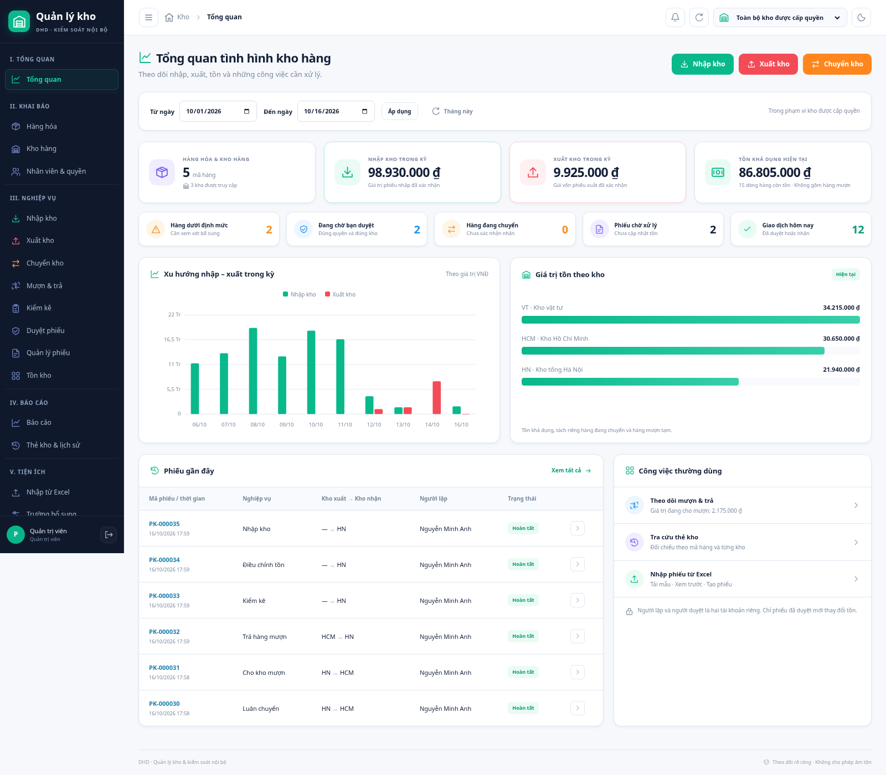

# DHD — Quản lý kho & kiểm soát nội bộ

Ứng dụng web tiếng Việt để quản lý nhiều kho, số lượng và giá trị hàng hóa. Django 5.2 LTS, PostgreSQL cho môi trường online; giao diện kho và bộ đọc QR dùng tài nguyên nội bộ. Kết nối Drive tùy chọn tải bộ chọn chính thức của Google trên trang cấu hình quản trị.

**Bản cải tiến được chủ dự án yêu cầu phát hành ngày 16/10/2026.** Website chính triển khai từ nhánh `main`; phát triển tiếp ở nhánh riêng và chỉ phát hành khi chủ dự án yêu cầu.

Nhánh hiện tại `feature/admin-function-permissions` kế thừa `feature/asset-control-details`, **chưa phát hành**. Bổ sung kiểm kê QR theo kho, biên bản → phiếu chênh lệch → Tổng giám đốc duyệt mới cập nhật tồn; ảnh theo mã hàng, hóa đơn theo đợt nhập và tích hợp Drive riêng tư. Cần cấu hình OAuth Google và thử kết nối thật trước khi dùng tệp online. Xem [hướng dẫn QR/Drive](docs/QR_STOCKTAKE_AND_DRIVE.md), [kiểm thử QR và giới hạn nghiệm thu](docs/QR_VALIDATION.md), [rà soát vận hành và hướng quản lý công ty](docs/COMPANY_PLATFORM_REVIEW.md).

Quy tắc ngày hôm nay, thực nhận/thiếu/không nhận và dữ liệu chi tiết được mô tả tại [kiểm soát chứng từ](docs/ASSET_CONTROL_DETAILS.md). Nhánh này có migration 0008–0016 so với production schema 0007; cần sao lưu và thử nâng cấp trước khi phát hành.

**Quyền mới theo yêu cầu chủ dự án:** admin dùng toàn bộ chức năng; tài khoản khác chỉ xem và thao tác những mục được admin cấp. Có bảng quyền theo nghiệp vụ, kiểm tra phía máy chủ, phạm vi kho và thu hồi quyền ngay ở lần truy cập tiếp theo. Xem [hướng dẫn cấp quyền](docs/FUNCTION_ACCESS.md), [135 kiểm thử và kiểm tra phát hành](docs/FUNCTION_ACCESS_VALIDATION.md), [đề xuất nhân sự chờ duyệt](docs/HR_COMPANY_PROPOSAL.md). Chủ dự án đã yêu cầu phát hành sau kiểm tra; trước khi chuyển main cần hoàn tất sao lưu production.



## Quy trình sử dụng

- Menu chia thành Tổng quan, Khai báo, Nghiệp vụ, Báo cáo và Tiện ích.
- Nhập, xuất, chuyển, kiểm kê và điều chỉnh có biểu mẫu riêng; tự điền kho khi xác định được phạm vi làm việc.
- Một dòng hàng ban đầu, tìm mã hoặc tên không dấu, thêm/xóa dòng, tính tạm tiền, hiển thị tồn khả dụng.
- Nhập phiếu từ Excel: tải mẫu → kiểm tra → xem trước → tạo phiếu chờ duyệt.
- Hàng chờ duyệt đúng kho, đúng người, đúng giai đoạn; người lập không tự duyệt. Trạng thái và người được phân công hiển thị trong chi tiết phiếu.
- Luân chuyển chính thức có bước chuyển đi và xác nhận nhận hàng. Mượn dùng sổ trung gian bị khóa, trả từng phần theo lệnh gốc và giữ nguyên giá trị mượn.
- Thiếu tồn được chặn khi tạo phiếu và được kiểm tra lại trong transaction khi duyệt. Khóa PostgreSQL chặn xuất quá tồn khi nhiều người thao tác.
- Bộ lọc kho thống nhất giữa các màn hình. Tổng quan có khoảng ngày và biểu đồ dữ liệu thực; các đơn vị tính khác nhau không bị cộng chung.
- Quản lý kho, nhân viên, vai trò và trường bổ sung trong giao diện chính. Danh mục/phiếu có tìm kiếm và phân trang.
- Quản trị viên quy định tên đăng nhập. Mật khẩu do người dùng tự chọn theo yêu cầu chủ dự án, không bắt buộc độ dài hoặc tổ hợp ký tự; không cho mật khẩu rỗng. Người dùng tự đổi mật khẩu sau khi xác nhận mật khẩu hiện tại. Mật khẩu được băm bằng Django.
- Hỗ trợ điện thoại, menu thu gọn và giao diện sáng/tối.
- Kiểm kê QR: mỗi mã hàng một QR tự sinh, mỗi lượt quét cộng 1; không coi chưa đếm là 0, không duyệt số đếm có mốc tồn đã cũ. Admin có toàn quyền; tài khoản khác được cấp riêng từng chức năng, quyền duyệt điều chỉnh có thể cấp cho Tổng giám đốc.
- Hồ sơ sản phẩm có ảnh tùy chọn và lịch sử hóa đơn nhóm theo đợt nhập. Một hóa đơn nhiều mã chỉ lưu một lần ở phiếu nhập. Bản online lưu tệp trên Drive đã được chủ tài khoản cấp quyền, không dùng ổ đĩa tạm Render.

## Phát triển cục bộ

```sh
python3 -m venv .venv
.venv/bin/pip install -r requirements.txt
.venv/bin/python manage.py migrate --noinput
.venv/bin/python manage.py setup_roles
.venv/bin/python manage.py createsuperuser
.venv/bin/python manage.py runserver 127.0.0.1:8000
```

Mỗi task cloud đã được tách biệt; dùng checkout hiện có, không tạo worktree nếu không được yêu cầu. Trong môi trường đang làm việc, Python environment là `/workspace/.venv-inventory`. Không dùng dữ liệu mẫu hoặc URL DB production để chạy thử. `demo_data` chỉ hỗ trợ DB trống sau khi tạo quản trị viên.

## Kiểm tra

```sh
.venv/bin/python manage.py test -v 2
.venv/bin/python manage.py check
.venv/bin/python manage.py makemigrations --check --dry-run
```

Đặt `DATABASE_URL` trỏ PostgreSQL **thử nghiệm** để chạy cả kiểm thử đồng thời; tài khoản DB test cần quyền tạo DB test. SQLite bỏ qua bài kiểm thử khóa dòng.

Bản phát triển hiện tại đã chạy **135 test PostgreSQL, 135 đạt, không bỏ qua**. Đã kiểm tra Chromium với tài khoản thử nhân viên/quản lý/Tổng giám đốc: nhập, xuất, chuyển hai bước, mượn, trả từng phần, kiểm kê, điều chỉnh, Excel, đổi mật khẩu; bộ giải mã QR thật đọc video camera mô phỏng và ảnh, thử lại lượt đếm khi mất phản hồi. Chi tiết đợt hiện tại tại [kết quả kiểm tra quyền](docs/FUNCTION_ACCESS_VALIDATION.md); [kiểm tra QR](docs/QR_VALIDATION.md) giữ bằng chứng của đợt trước. [Kết quả bản giao diện đã phát hành trước đây](docs/WORKSPACE_VALIDATION.md) được giữ làm lịch sử.

## Cấu trúc và tài liệu

- `inventory/services.py`: nghiệp vụ ghi sổ và kiểm soát quyền.
- `inventory/forms.py`: biểu mẫu và kiểm tra đầu vào.
- `inventory/workspace.py`: phạm vi kho dùng chung.
- `inventory/stocktakes.py`: phiên kiểm kê, số đếm, chống lặp và tạo phiếu chênh lệch.
- `inventory/access.py`, `inventory/media.py`, `inventory/drive.py`: quyền hồ sơ, xác minh tệp và lưu trữ Drive.
- `inventory/views.py`: các màn hình và xuất dữ liệu.
- `templates/`: giao diện Django; `static/app.css`: thiết kế; `static/document-form.js`: thao tác dòng hàng; `static/dashboard.js`: biểu đồ từ dữ liệu thật.
- [Hướng dẫn công việc](docs/WORKSPACE_GUIDE.md)
- [Giữ production ổn định và phát hành bản mới](docs/RELEASE_PROCESS.md)
- [Triển khai Render / Neon](docs/FREE_HOSTING.md)
- [Kiến trúc và định giá](docs/ARCHITECTURE.md)

Production dùng PostgreSQL, `DEBUG=0`, `SECRET_KEY` bảo mật và hostname HTTPS hợp lệ. `render.yaml`, Dockerfile, `build.sh` và `start.sh` giữ cơ chế triển khai hiện có; access log bỏ query string để không ghi mã OAuth vào log. Bí mật nhập trong hosting; không gửi vào chat hoặc ghi vào Git. Migration đã được thử từ schema 0007 trên dữ liệu thử, giữ tài khoản, mật khẩu băm, ngày chứng từ và tồn cũ; vẫn cần backup dữ liệu thật trước khi triển khai.

Các giới hạn hiện tại: chưa theo dõi lô / hạn sử dụng theo lựa chọn chủ dự án; chưa có FIFO, nhận hàng từng phần, hủy hàng đang chuyển, kiểm kê riêng tồn mượn hoặc báo cáo tồn cuối kỳ hồi tố. Tổng quan nhập/xuất theo kỳ, còn số tồn hiển thị là tồn hiện tại. File nhập tối đa 50 mã hàng / 5 MB, dùng `.xlsx`; xuất báo cáo CSV mở được bằng Excel.
