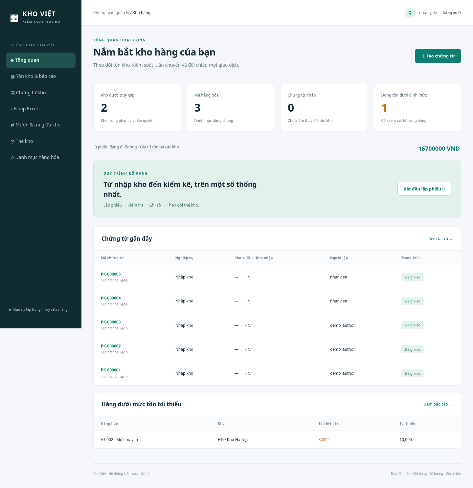

# Kho Việt — Phần mềm kiểm soát nội bộ nhiều kho

Bản đầu của ứng dụng web tiếng Việt, quản lý theo mã hàng, số lượng và giá trị VNĐ. Dùng Django 5.2 LTS, PostgreSQL khi triển khai online; SQLite để thử cục bộ. Chưa có website công khai hoặc DB online được tạo.



## Chức năng đã xây dựng

- Quản lý nhiều kho, danh mục hàng hóa, đơn vị tính và mức tồn tối thiểu.
- Nhập, xuất, luân chuyển, lệnh mượn, trả từng phần, kiểm kê và điều chỉnh có lý do.
- Nhập phiếu nhập kho từ Excel `.xlsx`: tải mẫu, kiểm tra từng dòng, xem trước, xác nhận tạo phiếu nháp. Tối đa 50 mã hàng / file, 5 MB. Không tạo tự động mã hàng chưa có và không ghi sổ tự động.
- Người lập không tự duyệt. Nhập / kiểm kê / điều chỉnh do quản lý kho nhận xác nhận. Xuất do người được admin chỉ định cho kho xuất duyệt. Superuser có thể hỗ trợ duyệt nhưng vẫn không được tự duyệt phiếu mình lập.
- Chuyển chính thức: duyệt xuất trừ tồn, theo dõi đang chuyển, quản lý kho nhận xác nhận mới cộng tồn.
- Hàng mượn dùng sổ trung gian riêng, không vào tồn khả dụng của kho mượn; không được xuất, chuyển, điều chỉnh hoặc cho mượn tiếp bằng số hàng mượn. Trả theo lệnh gốc và giữ nguyên giá trị đã mượn.
- Chống âm tồn, trả vượt số đã mượn, xác nhận hai lần và xuất quá tồn khi có nhiều người thao tác đồng thời trên PostgreSQL.
- Giá vốn bình quân liên hoàn theo từng kho; thẻ kho có biến động số lượng và giá trị, người lập / duyệt và thời điểm.
- Báo cáo tồn, cảnh báo dưới mức tối thiểu, sổ mượn trả, xuất CSV tồn và thẻ kho.
- Nhân viên, vai trò, phạm vi kho; trường văn bản bổ sung cho hàng hóa, không cần sửa mã nguồn.

## Chạy môi trường phát triển

Từ thư mục gốc của kho mã:

```sh
python3 -m venv .venv
.venv/bin/pip install -r requirements.txt
.venv/bin/python manage.py migrate --noinput
.venv/bin/python manage.py setup_roles
.venv/bin/python manage.py createsuperuser
.venv/bin/python manage.py collectstatic --noinput
.venv/bin/python manage.py runserver 127.0.0.1:8000
```

Tự nhập mật khẩu khi `createsuperuser` yêu cầu. Không có mật khẩu mặc định trong mã nguồn. Có thể dùng `demo_data` sau khi tạo superuser, chỉ trên DB chưa có kho/hàng/chứng từ; lệnh từ chối nếu đã có dữ liệu. Không dùng dữ liệu mẫu làm dữ liệu thật.

Tại môi trường cloud hiện tại đã có Python environment `/workspace/.venv-inventory`. Dữ liệu và tài khoản thử cục bộ không nằm trong Git; các mật khẩu ngẫu nhiên của kiểm thử không phải tài khoản bàn giao để dùng thật.

## Kiểm thử

```sh
.venv/bin/python manage.py test -v 2
.venv/bin/python manage.py check
.venv/bin/python manage.py makemigrations --check --dry-run
```

SQLite bỏ qua kiểm thử khóa đồng thời; cần chạy test với `DATABASE_URL` trỏ PostgreSQL thử nghiệm để xác minh. PostgreSQL user chạy test cần quyền tạo DB test; không trỏ vào DB sản xuất. Đã chạy thành công 37 bài kiểm thử trên PostgreSQL 17 trong quá trình xây dựng, gồm bài kiểm thử hai luồng cùng xuất. Đã kiểm tra trên Chromium quy trình Excel → xem trước → nhân viên tạo phiếu → quản lý kho khác tài khoản xác nhận, cùng giao diện desktop / điện thoại. Chi tiết mới nhất trong `docs/VALIDATION.md`.

## Hướng dẫn

- [Cách sử dụng cho người mới](docs/HUONG_DAN.md)
- [Lưu trữ miễn phí, Google Drive và các bước đăng ký](docs/FREE_HOSTING.md)
- [Triển khai web và DB online](docs/DEPLOYMENT.md)
- [Kiến trúc, định giá và mở rộng](docs/ARCHITECTURE.md)

Bản đầu chưa có theo dõi lô / hạn sử dụng theo lựa chọn của chủ dự án. Chưa có giá FIFO, thuế / chi phí phân bổ, sổ mượn kiểm kê riêng, thông báo, quy trình tự cấu hình, phiếu nhận từng phần hoặc xử lý hủy hàng đang chuyển. Khi nhận chuyển/mượn/trả, chỉ xác nhận sau khi kiểm tra đủ toàn bộ phiếu; sai lệch phải đối chiếu trước khi xác nhận. Các mục này có thể phát triển tiếp, không tự ý chỉnh dữ liệu DB.
